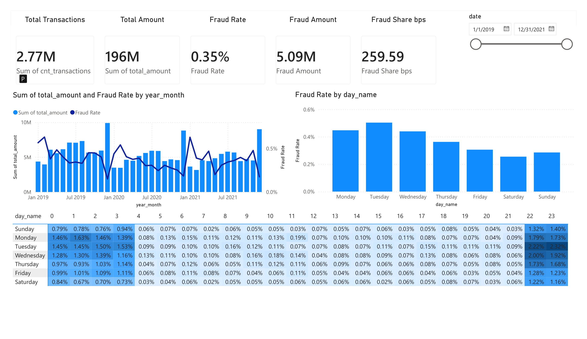
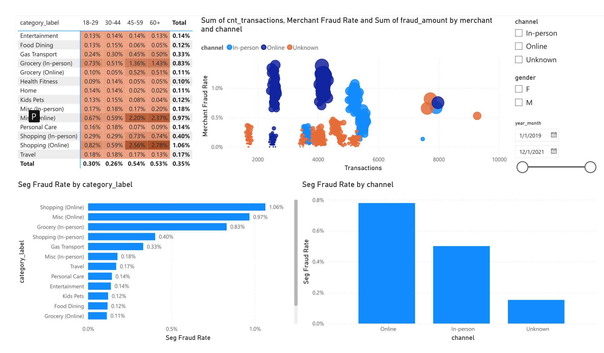
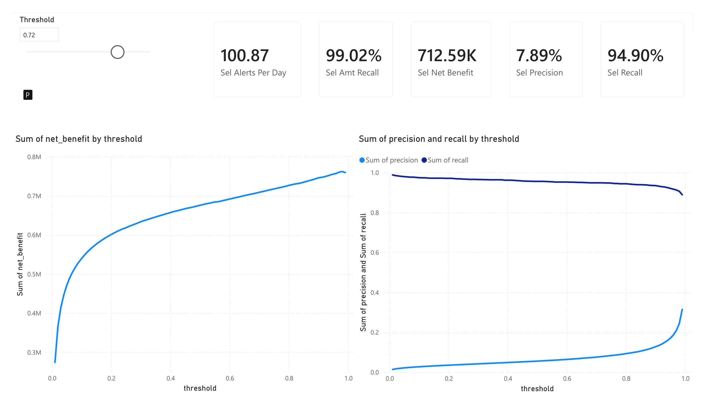
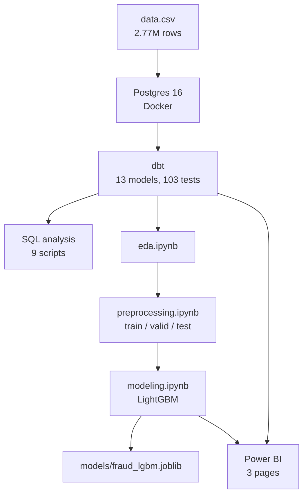

# Credit Card Fraud Detection

An end-to-end analytics project on 2.77 million card transactions. It starts with a raw CSV and ends with a Power BI dashboard that tells a fraud team which threshold to use and what that choice costs in dollars.

The stack is Postgres in Docker, dbt for the transformation layer, Python for analysis and modeling, and Power BI for the front end.

**The short version:** a one-line business rule catches 74.5% of fraud dollars. The model catches 91.7%. At the chosen alert threshold that is about **$1.5M a year in net benefit** for a team reviewing **31 alerts a day**.

---

## The dashboard



Page 1 answers "how bad is it and when does it happen". The heatmap at the bottom is the most useful thing on the page: fraud runs 2.32% at 23:00 on Tuesdays against a 0.35% baseline, and close to zero between 4am and noon.



Page 2 answers "where does it happen". Online shopping runs 1.06% fraud against 0.40% for the same category in person. Each dot in the scatter is one of 693 merchants, colored by channel.



Page 3 is the one I care about most. Drag the threshold slider and the cards recalculate: how much fraud you catch, how many false alarms your team has to review, and what the net dollar benefit is. The curve stays fixed so you can see where the optimum sits.

---

## Results

| | Business rule | Final model |
|---|---|---|
| ROC-AUC | 0.747 | **0.988** |
| PR-AUC | 0.045 | **0.784** |
| Fraud dollars caught | 74.5% | **91.7%** |

Both measured the same way, both on the test set the model never saw.

At the working threshold of 0.98:

| Metric | Value |
|---|---|
| Fraud transactions caught | 90.7% |
| Fraud dollars caught | 97.4% |
| Precision | 24.4% |
| Alerts per day | 31 |
| Net benefit (valid) | $762,062 |
| Net benefit (test) | **$859,022** |

The test figure being higher than the validation figure matters. The threshold was picked on validation data and then applied to test without any retuning. The dollar story held up on six months of data the model had never seen.

---

## How it fits together



Everything downstream reads from dbt. There is one definition of a transaction, one definition of a fraud rate, and both the notebooks and the dashboard use it.

---

## The data

[Sparkov / Kaggle simulated credit card transactions](https://www.kaggle.com/datasets/kartik2112/fraud-detection). Simulated, not real, which matters for how far you can trust the conclusions.

| | |
|---|---|
| Transactions | 2,766,578 |
| Date range | 2019-01-01 to 2021-12-31 |
| Cards | 998 |
| Merchants | 693 |
| Fraud rate | 0.347% |
| Total volume | $196,068,650 |
| Average fraud charge | $530 |
| Average normal charge | $69 |

Fraud is rare but expensive. It is a third of a percent of transactions, and each fraudulent charge averages almost 8x a normal one. That gap is why every metric in this project is reported twice, once by transaction count and once by dollars. A model that catches lots of small fraud and misses the big ones would look fine on recall and be useless in practice.

---

## Stage 1: Postgres in Docker

`docker-compose.yml` brings up Postgres 16 and Adminer. The raw CSV is mounted into the container and loaded by `sql/create_raw.sql`, which creates every column as `TEXT`.

That is deliberate. The source file has dates split across two columns, zip codes that lost their leading zeros to a float conversion somewhere upstream, and card numbers in scientific notation. Loading everything as text first means the load never fails, and all the type casting happens in one place downstream where it can be read and reviewed.

## Stage 2: SQL analysis

Nine standalone queries in `sql/`, written before any Python. Each one ends with an `INSIGHT` comment recording what it found.

| Script | Question |
|---|---|
| `01_fraud_sessions.sql` | Does fraud come in bursts or one-off charges? |
| `02_txn_rank_amount.sql` | Where does a fraud charge rank against the card's own history? |
| `03_overall_kpis.sql` | Headline numbers |
| `04_hourly_kpis.sql` | What time of day is risky? |
| `05_top_10_merchants.sql` | Which merchants carry the most fraud? |
| `06_fraud_share_by_category.sql` | Which categories? |
| `07_ratio_to_30d_avg.sql` | Does spend relative to the card's own average predict fraud? |
| `08_fraud_rate_by_age_gender.sql` | Do demographics matter? |
| `09_fraud_by_distance.sql` | Does distance from home matter? |

Script 07 found the signal the whole project rests on, and script 09 found a clean negative result. Both are covered below.

## Stage 3: dbt

The transformation layer. 13 models in three layers, 103 tests, all passing.

```
staging/     public_staging   stg_transactions
dimensions/  public_core      dim_customers, dim_merchants, dim_date, dim_category
facts/       public_core      fact_transactions
marts/       public_marts     8 marts
```

**Staging** does all the type casting and cleaning in one model. Timestamps are built from date plus time rather than the unix column. Merchant names lose their `fraud_` prefix. Card numbers are carried both as an id and as a SHA-256 hash. Rows get a `train` / `valid` / `test` label based on date, so the split is decided once, in SQL, and every consumer inherits it.

**Core** is a normal star schema. `fact_transactions` adds hour, day of week, Haversine distance between the customer's home and the merchant, and amount bands.

**Marts** are the layer everything else reads:

| Mart | Grain | Used by |
|---|---|---|
| `mart_daily_kpi` | day | dashboard page 1 |
| `mart_hourly_kpi` | weekday x hour | dashboard page 1 |
| `mart_segment_kpi` | month x gender x age x category | dashboard page 2 |
| `mart_merchant_risk` | merchant | dashboard page 2 |
| `mart_card_profile` | card | analysis |
| `mart_card_velocity` | transaction | model features |
| `mart_fraud_sessions` | fraud burst | analysis |
| `mart_transactions_enriched` | transaction | Python |

`mart_card_velocity` is the important one. It builds the behavioral features with window functions, and every window ends one second before the current row. Nothing in it can see the future. This is the part of a fraud project that is easiest to get wrong: if the 30-day average includes the transaction you are scoring, the model looks great in testing and fails in production.

Two things the tests protect:

- **Primary keys and referential integrity.** Every model has a uniqueness test on its key, and the fact and the marts have relationship tests back to the dimensions.
- **Categorical domains.** `split_period`, `age_bucket`, `gender`, `amt_bucket` and both day-of-week encodings have `accepted_values` tests, because the Python code downstream assumes those exact values.

There is one trap documented in the dbt README worth repeating here. `fact_transactions.day_of_week` uses Postgres `DOW` (0 = Sunday) because it is a frozen model feature, while `dim_date.day_of_week` uses ISO (1 = Monday). They must not be joined to each other. `dim_date.day_of_week_pg` exists for that, and both tables carry a `day_name` column for display.

## Stage 4: Exploration

`notebooks/eda.ipynb`. Distributions, fraud rate cut by every available dimension, rolling time series, and chi-square tests with Cramér's V to separate real relationships from ones that only look real on a bar chart.

The chi-square step earned its place. Distance from home looks like it should matter, and a bar chart of fraud rate by distance bucket has visible variation. The test returned p = 0.63. There is no relationship there, and the eventual SHAP analysis agreed.

## Stage 5: Feature preparation

`notebooks/preprocessing.ipynb` cuts 33 columns down to 17 features.

Ten columns are dropped because they leak card identity. There are only 998 cards, and each has exactly one city, job and zip code. A model given those columns memorizes individual cardholders instead of learning fraud behavior, and the score looks great until it meets a new customer.

The split is chronological, not random:

| Split | Rows | Period | Fraud rate |
|---|---|---|---|
| train | 1,843,822 | 2019-01-01 to 2020-12-31 | 0.346% |
| valid | 398,725 | 2021-01-01 to 2021-06-30 | 0.379% |
| test | 524,031 | 2021-07-01 to 2021-12-31 | 0.328% |

A random split would let the model train on December and predict January, which is not a situation that exists in production. An assertion in the notebook checks that the three periods do not overlap.

## Stage 6: Modeling

`notebooks/modeling.ipynb`. One rule at the top of the notebook: the test set is opened exactly once, at the end, and nothing is changed afterward.

| Model | PR-AUC | ROC-AUC | Fraud dollars caught |
|---|---|---|---|
| Rule: ratio >= 5x | 0.044 | 0.741 | 74.2% |
| Rule: ratio >= 5x or no history | 0.045 | 0.747 | 74.5% |
| LightGBM, defaults | 0.553 | 0.723 | — |
| XGBoost, defaults | 0.343 | 0.601 | — |
| LightGBM + Optuna | 0.631 | 0.827 | 93.0% |
| LightGBM + Optuna + undersampling | **0.807** | **0.989** | 93.0% |
| Same model on test | **0.784** | **0.988** | 91.7% |

Three things worth pulling out of that table.

**The business rule comes first.** Before any model, I built the rule a bank could ship tomorrow: flag anything at 5x the card's own 30-day average. It gets 0.747 ROC-AUC and catches 74.5% of fraud dollars on its own. Every model after it has to beat that number to justify existing. Note that PR-AUC and ROC-AUC are not really fair to a rule that only outputs 0 or 1, which is why the dollar column is the honest comparison.

**Undersampling beat tuning.** Optuna moved PR-AUC from 0.553 to 0.631. Undersampling the majority class moved it from 0.631 to 0.807. On this dataset the class imbalance mattered more than the hyperparameters, which is the opposite of where most of the effort usually goes.

**The gap between valid and test is small.** 0.807 to 0.784 on PR-AUC, everything else within a point. Test covers the last six months of the data, a period nothing in training or tuning ever touched.

SHAP confirmed the EDA. `category` came out strongest, slightly ahead of `ratio_to_30d_avg` — probably because a single split on category captures several risk factors at once. `distance_km` barely moves the model, which matches the chi-square result from EDA. Two independent methods reaching the same negative conclusion is worth more than either alone.

## Stage 7: Threshold and dollars

A probability is not a decision. This section turns the model output into a yes/no call and prices it.

For every threshold from 0.01 to 0.99:

```
net_benefit = fraud_dollars_caught − (false_alarms × $5)
```

Two assumptions, both stated rather than hidden: a manual review costs $5, and a caught fraud is fully recovered. Neither is measured. They are inputs a fraud manager would replace with their own numbers, which is exactly why the dashboard has a slider.

The optimum sits at 0.98. Not 0.5 — anyone loading the saved model and applying a default cutoff would get a completely different alert volume, which is why the threshold ships inside the model artifact.

`models/fraud_lgbm.joblib` contains the model, the threshold, the feature order, the categorical level mappings, the cost assumptions, and the test metrics. The categorical mappings are there for a specific reason: LightGBM stores categorical splits as integer codes, so a scoring script that rebuilds those categories from different data gets shifted codes and silently wrong predictions, with no error. A round-trip test in the notebook reloads the artifact and asserts it reproduces the test predictions exactly.

## Stage 8: Power BI

Three pages, built on the aggregate marts. Total import is about 7,000 rows across seven tables, so the file stays small and refresh is instant. The 2.77M-row transaction marts are deliberately not imported.

The measures are the part worth explaining. Every rate is recomputed from counts:

```
Fraud Rate = DIVIDE(SUM(mart_daily_kpi[cnt_fraud]), SUM(mart_daily_kpi[cnt_transactions]))
```

The marts do contain precomputed ratio columns, and dragging one onto a visual gives a wrong answer at any grain above a single row, because Power BI sums it. Each mart also gets its own measures rather than sharing one set. A fraud rate measure written against the daily mart cannot be sliced by category, because those two marts only meet at the date dimension.

Page 3 uses a What-If parameter. The parameter table is disconnected from everything, so the slider updates the metric cards without filtering the curve behind them. You see the whole tradeoff and your position on it at the same time.

---

## What the data actually says

**A card's own history beats the dollar amount.** A $500 charge is unremarkable for someone who normally spends $600 and very suspicious for someone who normally spends $50. Fraud rate climbs from 0.13% below the card's own average to 9.2% above 10x it.

**Cards with no history are the riskiest group in the dataset.** A card's first ever transaction has an 11.4% fraud rate, the highest of any segment. The naive version of the 5x rule misses all of them, because in pandas `NaN >= 5` is `False`.

**Fraud has a sharp daily rhythm.** 22:00 to 03:00 averages 3.7x the baseline rate and peaks at 6.68x. 04:00 to 11:00 averages 0.26x. Hour of day costs nothing to compute and is available before a card has any history at all.

**Weekends have the most fraud and the lowest fraud rate.** Sunday has the highest fraud count of any day (1,550) and the second-lowest rate (0.286%), because weekend transaction volume is roughly double a weekday's. Tuesday has the highest rate at 0.504%. Count and rate answer different questions and it is easy to quote the wrong one.

**Channel matters more than category.** Online shopping runs 1.06% fraud, the same category in person runs 0.40%.

**Age compounds with channel.** Overall, customers 45 and over run about double the fraud rate of younger ones. Combine that with online shopping and it reaches 2.78%, roughly 8x the overall baseline.

**Fraud arrives in bursts.** Consecutive fraud on one card inside 24 hours groups into attack sessions rather than isolated charges.

## What did not work

Recorded because negative results are results.

- **Distance from home predicts nothing.** Chi-square p = 0.63, and SHAP agreed independently. A reasonable hypothesis that the data did not support.
- **XGBoost lost badly on defaults.** 0.343 PR-AUC against LightGBM's 0.553, so LightGBM was carried forward.
- **More trees made things worse.** `best_iteration_` came back as 1 in every LightGBM run. At this level of imbalance a single well-shaped tree beat the full ensemble every time.
- **CatBoost was planned and never run.** It was swapped for XGBoost early and never revisited. Its ordered target statistics might handle `state` and `category` differently.
- **Class weighting was never tried.** Only undersampling. I cannot say whether `scale_pos_weight` would have worked as well without discarding training rows.

## Limitations

The data is simulated. Real fraud patterns differ, and 998 cards is a small population to generalize from.

The $5 review cost and the 100% recovery rate are assumptions, not measurements. Every dollar figure moves if those change.

The model is not a production service. Feature engineering lives in a notebook rather than a shared module, and there is no drift monitoring or retraining trigger. All training data stops at mid-2021.

The undersampled model's raw scores are no longer calibrated probabilities. They rank well, which is all the threshold logic needs, but they should not be read as "this transaction has a 98% chance of being fraud".

---

## Repo structure

```
.
├── docker-compose.yml           Postgres 16 + Adminer
├── sql/
│   ├── create_raw.sql           raw table definition
│   └── 01..09_*.sql             nine analysis queries, each with an INSIGHT comment
├── fraud_project/               dbt project (13 models, 103 tests)
│   ├── models/staging/
│   ├── models/dimensions/
│   ├── models/facts/
│   ├── models/marts/
│   └── README.md                layer-by-layer detail and conventions
├── notebooks/
│   ├── eda.ipynb                exploration and statistical tests
│   ├── preprocessing.ipynb      feature selection and chronological split
│   └── modeling.ipynb           baselines, tuning, SHAP, threshold, dollars
├── models/
│   ├── fraud_lgbm.joblib        model + threshold + feature schema
│   └── model_card.json          the same facts in readable JSON
└── powerbi/
    ├── fraud_dashboard.pbit     template, no data
    ├── data/econ_curve.csv      threshold curve exported from the notebook
    └── screenshots/
```

Data files and the `.pbix` are gitignored. The raw CSV is around 930MB and a `.pbix` in import mode embeds a full copy of the data, both well past GitHub's limits.

## Running it yourself

Start the database and load the raw data:

```bash
docker compose up -d
```

```bash
docker exec -i fraud_db psql -U analyst -d fraud -f /sql/create_raw.sql
```

```bash
docker exec -i fraud_db psql -U analyst -d fraud -c "\copy raw_transactions FROM '/data/data.csv' CSV HEADER"
```

Build the transformation layer. You need a `fraud_project` profile in `~/.dbt/profiles.yml` pointing at `localhost:5433`:

```bash
cd fraud_project && dbt run && dbt test
```

Then run the notebooks in order: `eda.ipynb`, `preprocessing.ipynb`, `modeling.ipynb`.

For the dashboard, open `powerbi/fraud_dashboard.pbit` and point it at `localhost:5433`.

A full `dbt run` is dominated by `mart_card_velocity`. It counts distinct merchants per card per 24-hour window with a correlated subquery, once per row, across 2.77M rows.

## Stack

Postgres 16 · Docker · dbt 1.12 · Python 3.14 · pandas · scikit-learn · LightGBM · XGBoost · Optuna · SHAP · Power BI
